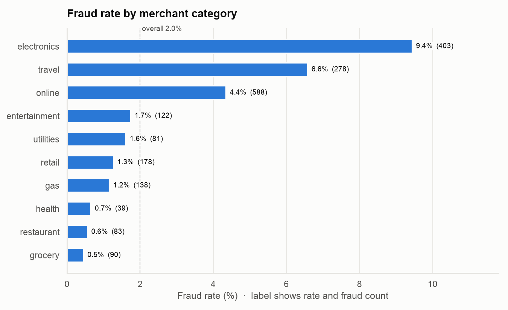
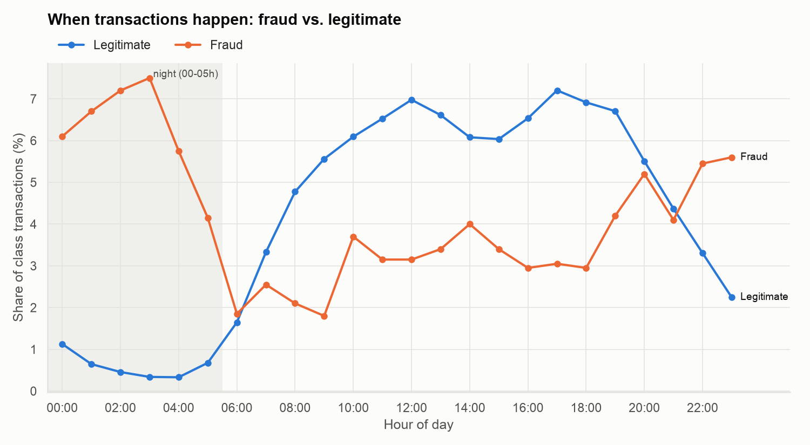
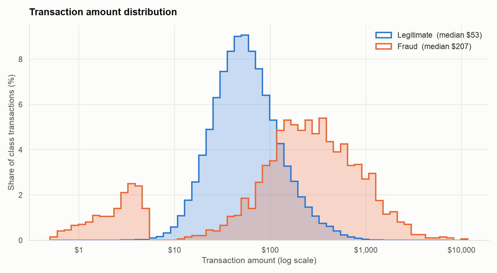
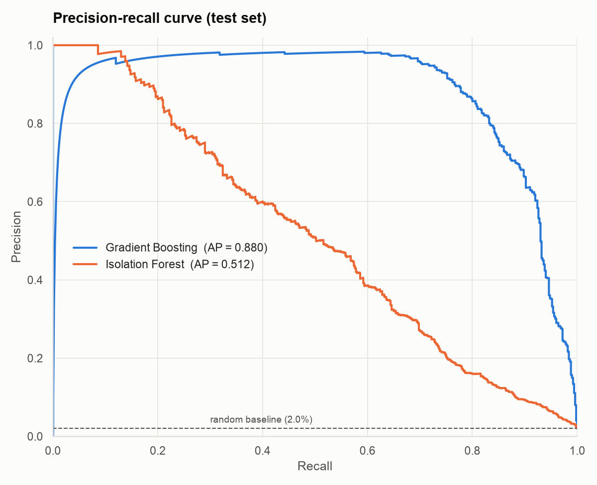

# Fraud Analytics

An end-to-end fraud detection analytics system in Python: synthetic transaction data, machine learning models, daily KPI monitoring, charts, and SQL analysis.

## Overview

| Component | File | What it does |
|---|---|---|
| Data generator | `data/generate_data.py` | Creates 100,000 synthetic card transactions with a ~2% fraud rate (seed 42) |
| ML pipeline | `src/pipeline.py` | Scales and encodes features, trains an Isolation Forest and a Gradient Boosting classifier, reports fraud-class precision / recall / F1, saves `model.pkl` |
| Monitoring | `src/monitoring.py` | Simulates daily batches, computes 30+ KPIs against a 7-day baseline, raises drift alerts, writes `output/daily_report.txt` |
| Visualizations | `src/visualizations.py` | Saves four PNG charts to `output/` |
| SQL analysis | `src/sql_analysis.py` | Loads the data into SQLite via SQLAlchemy and runs analytical queries |

### Dataset

| Column | Description |
|---|---|
| `transaction_id` | Unique ID (`TXN0000001`...) |
| `amount` | Transaction amount in USD |
| `merchant_category` | One of 10 categories (grocery, gas, online, travel, electronics, ...) |
| `hour_of_day` | 0-23 |
| `day_of_week` | 0 (Mon) - 6 (Sun) |
| `distance_from_home` | Distance from cardholder's home, km |
| `is_foreign` | 1 if the transaction is international |
| `previous_transaction_gap_hours` | Hours since the cardholder's previous transaction |
| `avg_amount_last_30d` | Cardholder's average transaction amount over the last 30 days |
| `is_fraud` | Label: 1 = fraud |

Fraud is generated with realistic signals that overlap with legitimate traffic: larger amounts relative to the 30-day average (plus some small "card testing" charges), late-night hours, longer distances, more foreign transactions, short gaps between transactions, and a skew toward electronics, travel, and online merchants.

## Setup

Requires Python 3.10+.

```bash
git clone https://github.com/swan28pande/fraud-analytics.git
cd fraud-analytics
python -m venv .venv
source .venv/bin/activate        # Windows: .venv\Scripts\activate
pip install -r requirements.txt
```

## Usage

Run the steps in order (each one depends on the output of the previous):

```bash
python data/generate_data.py     # -> data/transactions.csv
python src/pipeline.py           # -> model.pkl
python src/monitoring.py         # -> output/daily_report.txt
python src/visualizations.py     # -> output/*.png
python src/sql_analysis.py       # -> output/fraud.db + query results
```

Options:

```bash
python data/generate_data.py --rows 50000 --out data/small.csv
python src/monitoring.py --day 12     # report for a specific simulated day (1-30)
```

## Model results

Test set: 25% stratified hold-out (25,000 transactions, 500 fraud).

| Model | Precision | Recall | F1 | ROC AUC |
|---|---|---|---|---|
| Isolation Forest (unsupervised) | 0.496 | 0.516 | 0.506 | 0.942 |
| Gradient Boosting (supervised) | 0.892 | 0.778 | 0.831 | 0.994 |

The most important features are the amount-to-30-day-average ratio, the gap since the previous transaction, and distance from home. `amount_to_avg_ratio` is an engineered feature added during preprocessing.

## Daily monitoring

The dataset has no timestamps, so `monitoring.py` treats transactions as arriving in file order and splits them into 30 equal daily batches. Each batch is scored with `model.pkl` and compared with the average of the previous 7 days.

The report covers:

- **Volume & fraud:** transaction count, total amount, fraud count, daily fraud rate, fraud amount, fraud share of total dollars
- **Amounts:** average fraud and legit amounts, P50 / P90 / P99 amount, fraud P90, fraud rate for amounts >3x the 30-day average
- **Geography, velocity & time:** foreign share, foreign vs. domestic fraud rate, median distance, share and fraud rate of rapid transactions (<1h gap), median gap, night fraud rate and night share of fraud
- **Model performance:** alerts, TP / FP / FN, precision, recall, F1, false positive rate, average fraud score
- **Breakdowns:** fraud by merchant category, hourly fraud distribution, 30-day trend table with precision drift

Alerts fire when the fraud rate rises more than 25% above baseline, or when precision or recall drops more than 5 percentage points.

> The model is trained on a random 75% of the same dataset, so monitoring metrics are somewhat optimistic. In production the daily batches would be unseen data.

## Charts

| | |
|---|---|
|  |  |
|  |  |

## SQL analysis

`sql_analysis.py` loads the CSV into `output/fraud.db` (table `transactions`) and runs:

1. **Fraud rate by merchant category:** count, fraud rate, total and average fraud amount
2. **High-risk time windows:** day of week x 4-hour block, ranked by fraud rate relative to the overall rate
3. **Amount anomaly detection:** fraud rate by amount / 30-day-average band, plus the top 10 transactions by z-score of amount within their category
4. **Repeat fraud patterns:** recurring fraud profiles (category x foreign x night x rapid gap) and back-to-back fraud bursts in the transaction stream, using window functions

## Project structure

```
fraud-analytics/
├── data/
│   └── generate_data.py
├── src/
│   ├── common.py            # shared paths, feature lists, data loading
│   ├── pipeline.py
│   ├── monitoring.py
│   ├── visualizations.py
│   └── sql_analysis.py
├── output/                  # charts and daily report
├── requirements.txt
└── README.md
```

Generated files (`data/transactions.csv`, `model.pkl`, `output/fraud.db`) are not committed. Recreate them with the commands above.
